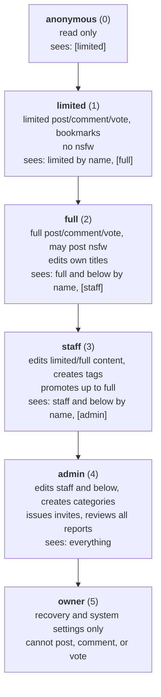

# visibility

the core of okmeme is a ring model. users on higher tiers see down into lower tiers; users on lower tiers see exactly one rung above them, and no further.

## the +1 rule

for a viewer at tier `T` looking at content at effective tier `E`:

| condition | result |
| --- | --- |
| `E <= T` | fully visible, real username shown |
| `E == T + 1` | visible, attributed to the **bare tier name only** |
| `E > T + 1` | does not exist as far as the viewer is concerned |

so a limited user knows `full` exists and nothing beyond it. a full user knows `staff` exists. an anonymous visitor sees limited-tier content labelled `[limited]`.

depth is never revealed past one rung. the number of tiers above you is not discoverable through the interface.



## author identity

**above-tier authors have no persistent identity.** every post a limited user sees from the tier above is attributed to the same bare `[full]` — indistinguishable from every other. two posts might be one person or twelve.

this is the point. a stable pseudonym that crosses a tier boundary is a lifetime correlation handle: posting times, topics, and phrasing accumulate against it, and the moment anything ties that handle to a real person, every post they ever made is retroactively deanonymised. the tier wall stops helping the instant a persistent identifier crosses it.

inside a single comment thread, above-tier participants get discriminators — `[full]`, `[full 2]` — scoped to that thread and meaningless anywhere else, so replies stay readable without accumulating into a profile.

## what the server sends

the api returns an **already-resolved** author object per viewer:

```jsonc
// viewer can identify the author
{ "author": { "kind": "user", "id": "u_8fk2", "name": "sandra" } }

// author is one rung above the viewer
{ "author": { "kind": "tier", "label": "full" } }
```

for above-tier authors the user id is **absent from the payload entirely** — not sent and hidden by the client. shipping identity to the browser and relying on the ui to suppress it is the single most common way a system like this leaks, and it survives every redesign until someone opens devtools.

the same rule applies to counts, timestamps of moderation actions, and anything else derived from data the viewer cannot see.

## effective tier

a post's visibility follows its **author's current tier**, not the tier they held when posting, unless a moderator has explicitly pinned it:

```sql
effective_tier = COALESCE(links.pinned_tier, author.tier)
```

`links.author_tier_at_post` is recorded for the audit trail but is never consulted for visibility.

consequences to design around:

- promotion and demotion retroactively move a user's entire back catalogue between tiers.
- feed pages therefore cannot be cached across a tier change. cache keys include the viewer tier, ttls stay short, and any tier change invalidates them.
- a moderator re-tier writes `pinned_tier`, which freezes that post permanently; the author's later movements no longer affect it.
- a deleted account's posts are pinned at their last effective tier, so the join has something to resolve against.

## nsfw

a boolean on the link, enforced in the query rather than the ui:

```sql
AND (NOT links.is_nsfw OR (viewer.tier >= 2 AND viewer.show_nsfw))
```

limited users never receive nsfw rows at all. full and above receive them according to their own preference, with thumbnails blurred until clicked.

## promotion and demotion

promotion is a **full retroactive reveal**. the moment a limited user becomes full, the api starts returning real usernames on all full-tier content, including posts made years earlier that they previously saw as `[full]`. this is intentional and stateless — there is no per-post visibility epoch. anyone posting to a tier is accepting that future members of that tier will see it.

demotion **cannot un-reveal**. a demoted user keeps everything they learned. the system does not pretend otherwise.

## invites

invite codes are generated by admins. because the issuer always outranks everyone, the inviter→invitee record creates no cross-tier knowledge: admins can already see every account.

this property is load-bearing. **if invite issuance is ever opened to a lower tier, it creates a permanent identity graph that crosses tier boundaries** — a full user who invited someone who later reaches staff knows a real identity inside a tier they are meant to be blind to, and no amount of label-hiding fixes it.

`settings.invite_min_tier` therefore is not an ordinary setting. it is writable by the **owner only**, the interface states plainly that lowering it creates that graph, and the change is audited. lowering it is also effectively irreversible: raising it back does not unbuild the graph it created while it was low.

codes are single-use, hashed at rest, expire after 14 days by default, and are revocable before consumption. a leaked code therefore costs at most one account and stops mattering quickly.

## structural leaks and how they're closed

things that leak through shape rather than content, and the rule that closes each:

| channel | rule |
| --- | --- |
| short pages revealing filtered rows | cursor pagination, fetch-until-filled, never offset |
| result totals (`showing 20 of 431`) | never returned, anywhere |
| absolute rank numbers | never displayed |
| sequential ids enabling enumeration | opaque public ids; serial pks never leave the database |
| comment counts on a card | show only the count the viewer can actually see, or none |
| moderation notices naming a tier | always generic *"moderator"*, at every tier |
| third-party image hosts logging viewers | all media proxied and re-served from okmeme's origin |
| an instance with no blob store falling back to hotlinking | it does not: thumbnails off means no image, never a foreign image |
| link unfurls revealing gated titles | every url unfurls as the same generic card |
| a global dedup check confirming hidden content | dedup runs only within the submitter's visible scope |
| a bookmark tombstone pinpointing a demotion | bookmarks are filtered by the ring predicate and drop silently |
| a suspension note naming a reporter or hidden content | notes are constrained to what the suspended user may see |
| a search index outside postgres drifting from the rules | search is in-database, on the same predicate |
| an unapproved tag putting one user's word in front of everyone | pending tags render only to their proposer and to staff |

leaks that are **accepted rather than closed** are listed in [GAPS.md](GAPS.md).

## comments (reserved)

not built. the visibility rule is fixed now because it constrains the schema:

**a comment whose parent is invisible to the viewer hides its entire subtree.** the alternatives are worse — reparenting orphans fabricates a conversation that never happened, and showing a reply with a missing parent announces that something is being withheld. hiding the subtree means the viewer sees a shorter thread and cannot tell whether it was short or pruned.

this requires `parent_id` and a materialised path or recursive walk that can be truncated server-side. comment counts obey the same rule as every other count: show what the viewer can see, or nothing.
